<div align="center">
  
</div>

# UserScripts

一组开源用户脚本合集。每个脚本都是 `source/` 下的一个独立小项目，使用
[webpack](https://webpack.js.org/) + [webpack-userscript](https://github.com/Jack-Works/webpack-userscript)
构建出带标准 UserScript 头的 `.user.js` 文件。

## 脚本列表

| 目录 | 脚本名 | 安装/更新源 | 许可 |
| --- | --- | --- | --- |
| [source/auto-login](source/auto-login) | Auto Login | release 分支 raw / 手动导入 ScriptCat | ISC |
| [source/disable-pcdn](source/disable-pcdn) | Disable Websites' PCDN | [GreasyFork 491421](https://greasyfork.org/zh-CN/scripts/491421) | MIT |
| [source/luogu-helper](source/luogu-helper) | 洛谷助手 | [GreasyFork 581027](https://greasyfork.org/zh-CN/scripts/581027) | MIT |
| [source/deepseek-ctrl-enter](source/deepseek-ctrl-enter) | DeepSeek: Ctrl+Enter to Send | release 分支 raw（GreasyFork 待发布） | MIT |

## 构建

每个子项目独立安装依赖、独立构建：

```powershell
cd source/<script>
npm install
npm run build
```

产物输出到各项目的 `dist/<script>.user.js`。也可以在仓库根目录执行：

```powershell
npm run build
```

## 脚本功能

### Auto Login

[source/auto-login](source/auto-login)

在浏览器里保存各站点的账号密码，匹配到登录页时自动填充并提交。
内置 1Panel、JumpServer、DataEase、Portainer、OMV、TrueNAS 等站点类型；
未内置的站点可以通过「示教模式」在页面上拾取元素，自由组合「填入用户名 / 填入密码 /
点击控件 / 等待」等操作，支持两步式登录（先填用户名 → 点下一步 → 等待密码框出现 → 填密码 → 登录）。

### Disable Websites' PCDN

[source/disable-pcdn](source/disable-pcdn)

阻止网站把访问者当成 PCDN 上传节点：删除页面中的 WebRTC / DataChannel 全局构造器
（`RTCPeerConnection` 等），让依赖 WebRTC 的 PCDN SDK 无法建立点对点连接。
当前匹配 `https://*.bilibili.com/*`。

### 洛谷助手

[source/luogu-helper](source/luogu-helper)

洛谷题目列表页增强：右下角悬浮按钮，点开后按「已通过 / 未通过 / 未做」分组统计题号，
支持一键复制题号；仅在 `/problem/list` 页面显示，兼容洛谷的 SPA 路由切换。

### DeepSeek: Ctrl+Enter to Send

[source/deepseek-ctrl-enter](source/deepseek-ctrl-enter)

把 chat.deepseek.com 的发送快捷键从 Enter 改为 Ctrl + Enter（macOS 上为 Cmd + Enter），
把换行还给 Enter；Shift + Enter 保持原有换行行为。输入法组合输入期间与搜索框不受影响。

## 目录约定

```
source/<slug>/
├─ src/                 # 可编辑源码
├─ dist/<slug>.user.js  # 构建产物（提交，可直接安装）
├─ webpack.config.cjs   # 构建与 UserScript 头元数据
├─ package.json
└─ README.md
```

`<slug>` 统一使用小写连字符格式。

## 持续集成

推送到 `main` 或提交 PR 时，GitHub Actions 会对每个脚本分别执行 `npm ci` + `npm run build`，
并检查 `dist/` 中的构建产物与源码一致（构建后工作区无差异），确保仓库里的产物始终可复现。

## 发布

打 `v*` 版本 tag 会触发 [Release workflow](.github/workflows/release.yml)：CI 重新构建全部脚本，
把产物以扁平文件名发布到 [`release` 分支](https://github.com/Dynesshely/UserScripts/tree/release)。
脚本平台（GreasyFork 等）通过 GitHub webhook + raw URL 自动拉取更新，不使用 GitHub Release 或 Package。

完整的仓库侧发布步骤与平台侧配置见 [docs/RELEASING.md](docs/RELEASING.md)。

发布后可直接用 raw 地址安装：

- <https://raw.githubusercontent.com/Dynesshely/UserScripts/release/auto-login.user.js>
- <https://raw.githubusercontent.com/Dynesshely/UserScripts/release/disable-pcdn.user.js>
- <https://raw.githubusercontent.com/Dynesshely/UserScripts/release/luogu-helper.user.js>
- <https://raw.githubusercontent.com/Dynesshely/UserScripts/release/deepseek-ctrl-enter.user.js>